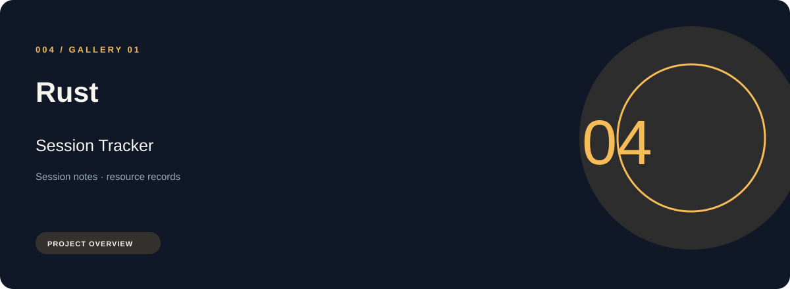
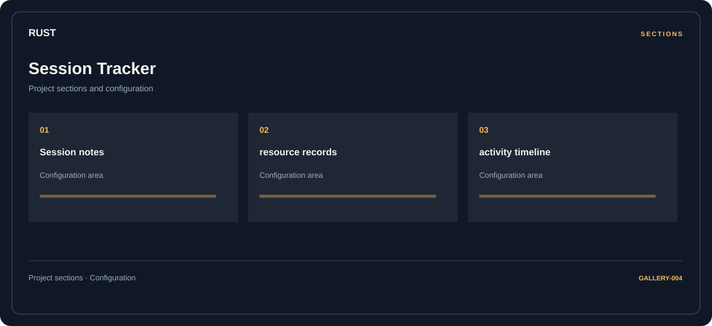

# 🛠️ Rust Session Tracker

**Session notes · Resource records · Activity timeline**

## ⚡ Features

A session tracker workspace for Rust, built around session notes and resource records, with activity timeline kept in a separate reference area.

### ⚙️ Session notes

Session and activity information grouped by the task or context it belongs to.

### 🧩 Resource records

Inventory and resource categories organized alongside their related values and notes.

### ⌨️ Activity timeline

Session and activity information grouped by the task or context it belongs to.

## 🖥️ Project navigation

## 📥 Download

The button and cover open the project's download page. Use the information supplied with the downloaded package for installation and release-specific requirements.

## 📚 Project documentation

- [Feature reference](docs/FEATURES.md)
- [Download information](docs/DOWNLOAD.md)
- [Project page](index.html)

---

Rust Session Tracker · Program documentation and download information.
                                                                                                    